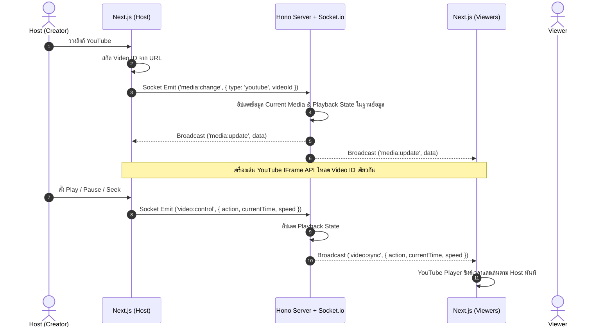
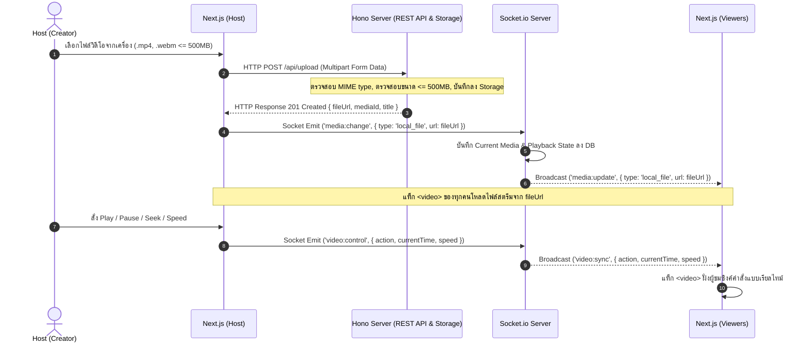
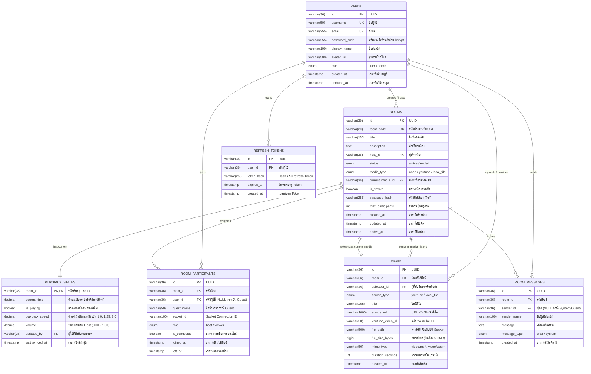

# 📄 Software Requirements Specification (SRS)

## 📌 ข้อมูลโครงงาน (Project Overview)
- **ชื่อโครงงาน (ภาษาไทย):** ยูสตรีม (ระบบรับชมวิดีโอร่วมกันแบบเรียลไทม์)
- **ชื่อโครงงาน (ภาษาอังกฤษ):** YouStream: Real-time Co-watching Platform
- **กลุ่มเป้าหมาย (Target Users):** 
  - กลุ่มเพื่อน ครอบครัว หรือกลุ่มผู้ใช้ทั่วไปที่ต้องการรับชมวิดีโอร่วมกันทางออนไลน์ในระยะไกล
  - ชุมชนออนไลน์ (Communities) หรือกลุ่มผู้ติดตามที่ต้องการจัดกิจกรรม Watch Party ร่วมกับผู้สร้างห้อง (Host)
  - ผู้ใช้งานที่ต้องการชมวิดีโอทั้งจาก YouTube หรือแชร์ไฟล์วิดีโอส่วนตัวร่วมกับผู้อื่นโดยไม่ต้องใช้ซอฟต์แวร์แชร์หน้าจอที่มีการกินแบนด์วิธสูง
- **ปัญหา / ที่มาของโครงงาน (Problem Statement & Pain Points):**
  - **ปัญหาความไม่ตรงกันของการเล่นวิดีโอ (Out-of-sync):** เมื่อผู้ใช้พยายามชมวิดีโอร่วมกันผ่านแอปพูดคุยทั่วไป มักต้องคอยนับถอยหลังกดเล่นพร้อมกัน ทำให้เกิดความคลาดเคลื่อนทางเวลา (Time Drift) และทำให้เสียอรรถรสในการรับชม
  - **การแชร์หน้าจอ (Screen Sharing) สิ้นเปลืองแบนด์วิธและคุณภาพต่ำ:** ซอฟต์แวร์แชร์หน้าจอทั่วไป (เช่น Discord, Zoom) ทำให้เครื่องของผู้แชร์ทำงานหนัก อาศัยอินเทอร์เน็ตความเร็วสูง และส่งผลให้คุณภาพของวิดีโอ (Bitrate/Framerate) ฝั่งผู้ชมลดลงอย่างมาก
  - **ข้อจำกัดของแพลตฟอร์ม Watch Party ทั่วไป:** แพลตฟอร์มส่วนใหญ่รองรับเฉพาะบริการสตรีมมิ่งภายนอกบางแห่ง ไม่รองรับการนำไฟล์วิดีโอส่วนตัว (Local Files เช่น .mp4, .webm) มาเปิดรับชมร่วมกันได้โดยตรง หรือมีข้อจำกัดเรื่องขนาดไฟล์และการควบคุมสิทธิ์
- **วัตถุประสงค์ (Objectives):**
  - เพื่อพัฒนาแพลตฟอร์มเว็บแอปพลิเคชันสำหรับการรับชมวิดีโอร่วมกันแบบเรียลไทม์ (Real-time Co-watching) ที่สามารถซิงโครไนซ์สถานะการเล่นระหว่างผู้สร้างห้อง (Host) และผู้ชม (Viewers) ได้อย่างแม่นยำ
  - เพื่อรองรับการเล่นสื่อจากหลากหลายแหล่ง (Multi-Source Media) ได้แก่ การเปิดวิดีโอจาก YouTube ผ่าน YouTube IFrame API และการอัปโหลดไฟล์วิดีโอจากเครื่องคอมพิวเตอร์ (Local Video Files ขนาดไม่เกิน 500MB) ไปยังระบบเพื่อสตรีมร่วมกัน
  - เพื่อพัฒนาระบบสิทธิ์การควบคุมโดย Host เพียงผู้เดียว (Host Control) ป้องกันความสับสนในการกดเล่น/หยุด/ข้ามเวลาจากผู้ใช้อื่น
  - เพื่อสร้างระบบหน้ารายการห้องรวม (Room Directory / Lobby) และห้องสนทนาเรียลไทม์ (Live Chat) ที่ช่วยเสริมสร้างปฏิสัมพันธ์ระหว่างผู้รับชม

---

## 👥 สมาชิกในกลุ่ม (Team Members)
| ลำดับ | รหัสนักศึกษา | ชื่อ - นามสกุล | บทบาทหน้าที่หลัก (Role) | GitHub Username |
| :---: | :---: | :--- | :--- | :--- |
| 1 | 6730300108 | นายชนกันต์ เขียวภักดี | Backend Developer / Database Designer | [@petegamez](https://github.com/petegamez) |
| 2 |  |  | Frontend Developer / UI Designer | [@Snowhazee](https://github.com/Snowhazee) |

---

## 🔗 ลิงก์ที่เกี่ยวข้อง (Important Deliverables Links)
- **Production URL (Deployed App):** [แนบลิงก์ที่ Deploy จริง เช่น Vercel / Railway]
- **GitHub Repository:** [https://github.com/PeterGamez/YouStream](https://github.com/PeterGamez/YouStream)
- **Figma Prototype:** [แนบลิงก์ Figma ที่แชร์สิทธิ์ Viewer]
- **Video Presentation & Demo:** [แนบลิงก์คลิป Unlisted เช่น YouTube / Google Drive]

### 🔑 บัญชีสำหรับทดสอบระบบ (Test Accounts)
| บทบาท (Role) | อีเมล / Username | รหัสผ่าน (Password) | สิทธิ์การเข้าถึง (Permissions) |
| :--- | :--- | :--- | :--- |
| Admin | `admin@youstream.app` | `Admin@1234` | จัดการผู้ใช้ทั้งหมด, ตรวจสอบและระงับห้องสตรีม, จัดการไฟล์วิดีโอบนระบบ |
| Host (User) | `host@youstream.app` | `Host@1234` | สร้างห้อง, สิทธิ์ควบคุมวิดีโอ (Host Control), อัปโหลดไฟล์วิดีโอ, จัดการห้อง |
| Viewer (User) | `viewer@youstream.app` | `Viewer@1234` | เข้าร่วมห้องสตรีม, ซิงค์การรับชม, ใช้งานแชทในห้อง, จัดการโปรไฟล์ |
| Guest | ไม่ต้องเข้าสู่ระบบ | - | เข้าชมหน้ารายการห้อง (Room Directory) และเข้าชมห้องสาธารณะในโหมดอ่าน/ดู |

---

## 🛠️ สถาปัตยกรรมและเทคโนโลยีที่ใช้ (Tech Stack)
- **Frontend:** 
  - Framework: [Next.js](https://nextjs.org/) (App Router, React 19)
  - Real-time Client: `socket.io-client`
  - Video Players: YouTube IFrame Player API (สำหรับ YouTube), HTML5 Video Element (สำหรับ Local File Streaming)
  - Styling: CSS Modules / Vanilla CSS (Modern Dark Theme UI)
- **Backend / API:** 
  - Server Framework: [Hono](https://hono.dev/) บน Node.js / Bun Runtime
  - Real-time Server: `socket.io` (จัดกลุ่มการกระจายข้อมูลผ่าน Socket Rooms)
  - File Handling: Multi-part Form Data Parser (รองรับการอัปโหลดไฟล์วิดีโอขนาดไม่เกิน 500MB)
- **Database:** 
  - Relational Database Management System: [MariaDB](https://mariadb.org/) / MySQL
  - Driver: `mysql2`
- **Authentication & Security:** 
  - JSON Web Tokens (JWT) สำหรับการยืนยันตัวตนแบบ Stateless
  - Password Hashing: `bcrypt`
  - OAuth 2.0 (Google Login)
- **Hosting & Deployment:** 
  - Backend & Database: OVHcloud / Railway
  - Frontend: Vercel / Railway
- **CI/CD & Version Control:** 
  - Git, GitHub Actions

---

## 📋 ข้อกำหนดของระบบ (System Requirements)

### 1. Functional Requirements (FR)

| รหัส (ID) | โมดูล (Module) | รายละเอียดฟังก์ชันการทำงาน (Description) | ลำดับความสำคัญ |
| :---: | :--- | :--- | :---: |
| **FR-01** | Authentication | ผู้ใช้สามารถลงทะเบียน (Sign up) เข้าสู่ระบบ (Sign in) ด้วยอีเมลและรหัสผ่าน หรือผ่าน OAuth 2.0 (Google) | High |
| **FR-02** | Authentication | ระบบทำการเข้ารหัสรหัสผ่านด้วย `bcrypt` ก่อนจัดเก็บ และออก JWT Access Token / Refresh Token สำหรับยืนยันตัวตน | High |
| **FR-03** | User Profile | ผู้ใช้สามารถดูและแก้ไขข้อมูลโปรไฟล์ (Display Name, Avatar URL) และเปลี่ยนรหัสผ่านได้ | Medium |
| **FR-04** | Room Directory | หน้ารวมห้อง (Lobby) แสดงรายการห้องที่กำลังเปิดสตรีมอยู่ (Active Rooms) พร้อมชื่อห้อง, ชื่อ Host, ประเภทสื่อที่กำลังเล่น, และจำนวนผู้ชมปัจจุบัน | High |
| **FR-05** | Room Directory | ผู้ใช้สามารถค้นหาห้องตามชื่อห้อง หรือกรองตามสถานะ/ประเภทของสื่อได้ | Medium |
| **FR-06** | Room Management | สมาชิกสามารถสร้างห้องสตรีมมิ่งใหม่ได้ โดยกำหนดชื่อห้อง รายละเอียด และการตั้งค่าความเป็นส่วนตัว (Public / Passcode Protected) | High |
| **FR-07** | Room Management | ระบบสร้างรหัสห้องที่ไม่ซ้ำกัน (Unique Room Code) เพื่อใช้เป็น URL ลิงก์สำหรับแชร์ให้ผู้ชมเข้าห้องได้ทันที | High |
| **FR-08** | Room Management | Host สามารถแก้ไขข้อมูลห้อง หรือสั่งปิดห้อง (End Room) ซึ่งจะนำผู้ใช้ออกจากห้องและเปลี่ยนสถานะเป็น Ended | High |
| **FR-09** | Host Control | ผู้สร้างห้อง (Host) เป็นผู้มีสิทธิ์ขาดเพียงคนเดียวในการควบคุมวิดีโอ (สั่ง Play, Pause, Seek/ข้ามเวลา, Volume, Playback Speed) | High |
| **FR-10** | Real-time Synchronization | เมื่อ Host ดำเนินการควบคุมวิดีโอ ระบบจะส่ง Event ผ่าน Socket.io ไปยัง Backend และทำการ Broadcast สถานะการเล่นไปยังผู้ชมทุกคนในห้องเดียวกันแบบเรียลไทม์ | High |
| **FR-11** | Late-Joiner Sync | เมื่อมีผู้ชมใหม่เข้าร่วมห้อง ระบบจะส่งสถานะปัจจุบันของวิดีโอ (Current Video, Time Offset, Playing State, Speed) ให้ผู้ใช้ใหม่ซิงค์ทันทีโดยไม่ต้องรอ Host สั่งการ | High |
| **FR-12** | YouTube Syncing | Host สามารถวางลิงก์ YouTube โดยระบบฝั่ง Frontend จะสกัดรหัส Video ID ออกมา แล้วส่งให้ Backend กระจายต่อไปยังผู้ชม | High |
| **FR-13** | YouTube Syncing | ฝั่งผู้ชมทำการแสดงผลวิดีโอผ่าน YouTube IFrame API และซิงค์สถานะตาม Host โดยไม่มีการดาวน์โหลดไฟล์วิดีโอมายังเซิร์ฟเวอร์ | High |
| **FR-14** | Local File Upload | Host สามารถเลือกไฟล์วิดีโอจากเครื่องคอมพิวเตอร์ (.mp4, .webm) ขนาดไม่เกิน 500MB และอัปโหลดไปยัง Backend ผ่าน Multipart API พร้อมแถบแสดงความคืบหน้า (Progress Bar) | High |
| **FR-15** | Local File Streaming | เซิร์ฟเวอร์ตรวจสอบความถูกต้องของไฟล์ บันทึกไฟล์ และส่งกลับเป็น Public URL สำหรับนำไปสตรีมผ่านแท็ก `<video>` ของเบราว์เซอร์ฝั่งผู้ชมทุกคน | High |
| **FR-16** | Media Switcher | Host สามารถสลับแหล่งวิดีโอระหว่าง YouTube และ Local Video File ได้ตลอดเวลาระหว่างเปิดห้องสตรีม | High |
| **FR-17** | In-Room Live Chat | ผู้ชมและ Host ในห้องสามารถส่งข้อความสนทนาแบบเรียลไทม์ผ่าน Socket.io ได้ | Medium |
| **FR-18** | Participant List | แสดงรายชื่อผู้เข้าร่วมห้องแบบเรียลไทม์ พร้อมสัญลักษณ์ระบุสถานะ Host | Medium |
| **FR-19** | Viewer Local Audio Control | ผู้ชมแต่ละคนสามารถปรับระดับเสียง (Local Volume) หรือปิดเสียง (Mute) บนเครื่องของตนเองได้ โดยไม่กระทบต่อผู้ใช้อื่นในห้อง | Medium |
| **FR-20** | Admin Dashboard | ผู้ดูแลระบบสามารถดูสถิติห้องที่กำลังเปิดใช้งาน, รายการผู้ใช้ทั้งหมด, และรายการไฟล์วิดีโอที่ถูกอัปโหลดในระบบ | Low |
| **FR-21** | Admin Management | ผู้ดูแลระบบสามารถสั่งปิดห้องที่ละเมิดข้อกำหนด และสั่งลบไฟล์วิดีโอขยะเพื่อคืนพื้นที่จัดเก็บ (Storage Cleanup) ได้ | Medium |

---

### 2. Non-Functional Requirements (NFR)

- **Performance & Latency:**
  - ค่าความหน่วงในการซิงค์สถานะวิดีโอ (Sync Latency) ผ่าน WebSocket/Socket.io ต้องน้อยกว่า 200 มิลลิวินาที ภายใต้สภาวะเครือข่ายอินเทอร์เน็ตปกติ
  - RESTful API ทั่วไปของ Hono ต้องมี Response Time เฉลี่ยไม่เกิน 300 มิลลิวินาที
  - ระบบรองรับการอัปโหลดไฟล์วิดีโอขนาดใหญ่ (สูงสุด 500MB) ได้อย่างราบรื่นโดยไม่บล็อก Event Loop ของเซิร์ฟเวอร์
- **Security & Authorization:**
  - รหัสผ่านของผู้ใช้ต้องถูกเข้ารหัสด้วย `bcrypt` (Salt Rounds >= 10)
  - มีการตรวจสอบสิทธิ์ (Authorization Middleware) เพื่อให้มั่นใจว่าคำสั่งควบคุมวิดีโอ (Play, Pause, Seek, Change Source) ส่งมาจาก Host ของห้องนั้นจริง
  - มีการตรวจสอบไฟล์อัปโหลดอย่างเคร่งครัด: ตรวจสอบ MIME Type (รองรับเฉพาะ `video/mp4`, `video/webm`), ขนาดไฟล์ไม่เกิน 500MB และป้องกันช่องโหว่ Path Traversal ในการจัดเก็บไฟล์
  - การเรียกใช้งาน API มีการป้องกัน SQL Injection ผ่าน Prepared Statements ของ `mysql2` และป้องกัน XSS บนระบบแชท
- **Usability & Responsiveness:**
  - รองรับการแสดงผลแบบ Responsive Design อย่างสมบูรณ์ทั้งบน Desktop (หน้าจอหลักสำหรับ Watch Party), Tablet และ Mobile
  - ใช้ชุดสีสไตล์ Dark Theme ที่ถนอมสายตาสำหรับการรับชมสื่อบันเทิงในที่มืด
- **Reliability & Scalability:**
  - ระบบมีกลไก Auto-Reconnection ของ Socket.io เพื่อเชื่อมต่อใหม่และดึงสถานะล่าสุดกลับมาเมื่ออินเทอร์เน็ตขัดข้องชั่วคราว
  - ระบบห้องแบ่งการสื่อสารด้วย Socket Room Channels เพื่อจำกัดปริมาณข้อมูลการ Broadcast ให้เฉพาะผู้ใช้ในห้องนั้นๆ

---

## 🎭 Use Cases & User Flow

### 1. Actors ในระบบ
1. **Guest (ผู้ใช้ทั่วไป):** ผู้ที่ยังไม่ได้เข้าสู่ระบบ สามารถเข้าดูรายการห้องใน Room Directory และรับชมห้องสาธารณะได้
2. **User / Member:** สมาชิกที่ลงทะเบียนและเข้าสู่ระบบแล้ว สามารถสร้างห้องสตรีมมิ่ง หรือเข้าร่วมห้องในฐานะผู้ชมได้
3. **Host (ผู้สร้างห้อง):** ผู้ใช้ที่เป็นเจ้าของห้อง มีสิทธิ์เต็มในการควบคุมการเล่นวิดีโอ เปลี่ยนแหล่งวิดีโอ อัปโหลดไฟล์ และปิดห้อง
4. **Viewer (ผู้ชม):** ผู้ใช้ที่เข้าร่วมห้องสตรีมของผู้อื่น วิดีโอจะซิงค์ตาม Host และสามารถแชทพูดคุยได้
5. **Admin (ผู้ดูแลระบบ):** ผู้ดูแลภาพรวมของระบบ จัดการห้อง ผู้ใช้ และพื้นที่จัดเก็บไฟล์

---

### 2. ตารางสรุป Use Case สำคัญ
| Use Case ID | Actor | ชื่อ Use Case | คำอธิบายสั้นๆ (Description) |
| :---: | :--- | :--- | :--- |
| **UC-01** | Guest / User | Register & Login | สมัครสมาชิกและเข้าสู่ระบบด้วย Email/Password หรือ Google OAuth เพื่อรับ JWT Token |
| **UC-02** | Guest / User | Browse Room Directory | ดูรายการห้องสตรีมทั้งหมดที่เปิดอยู่ ค้นหาห้อง และคลิกเพื่อเข้าร่วมห้อง |
| **UC-03** | User | Create Stream Room | สร้างห้องสตรีมมิ่งใหม่ กำหนดชื่อ รายละเอียด และรหัสผ่านเข้าห้อง (ถ้ามี) |
| **UC-04** | Host | Stream YouTube Video | นำลิงก์ YouTube มาใส่ ระบบสกัด Video ID และกระจายให้ผู้ชมทุกคนในห้องเล่นพร้อมกัน |
| **UC-05** | Host | Upload & Stream Local File | อัปโหลดไฟล์วิดีโอขนาดไม่เกิน 500MB รับ Public URL และบรอดแคสต์ให้ผู้ชมสตรีมผ่าน HTML5 Video |
| **UC-06** | Host | Control Video Playback | สั่ง Play, Pause, Seek, ปรับ Speed หรือระดับเสียง โดยระบบจะซิงค์ไปยังผู้ชมทุกคนแบบเรียลไทม์ |
| **UC-07** | Viewer | Watch & Auto-Sync Video | เข้ารับชมวิดีโอในห้อง โดยระบบจะซิงค์สถานะการเล่นให้ตรงกับ Host โดยอัตโนมัติตลอดเวลา |
| **UC-08** | Host / Viewer | In-Room Live Chat | ส่งข้อความสนทนาและแสดงความเห็นกับคนอื่นๆ ภายในห้องสตรีมมิ่ง |
| **UC-09** | Host | Close / End Room | สั่งสิ้นสุดการสตรีม ปิดห้อง และเตือนให้ผู้ชมทุกคนออกจากห้อง |
| **UC-10** | Admin | Manage System & Storage | ตรวจสอบห้องสตรีมมิ่ง ระงับห้องที่ไม่เหมาะสม และลบไฟล์วิดีโอที่หมดอายุออกจากเซิร์ฟเวอร์ |

---

### 3. แผนภาพลำดับการทำงาน (Workflows & How it Works)

#### 🎬 กลไกที่ 1: การเปิดวิดีโอจาก YouTube (YouTube Syncing)


---

#### 📁 กลไกที่ 2: การนำไฟล์วิดีโอมาเอง (Local File via Server Upload <= 500MB)


---

## 🗄️ โครงสร้างฐานข้อมูล (Database Schema & ER Diagram)

ระบบใช้ฐานข้อมูลแบบเชิงสัมพันธ์ (Relational Database) โดยใช้ **MariaDB / MySQL** ร่วมกับไดรเวอร์ `mysql2` ในฝั่ง Backend (Hono)

### 1. Entity Relationship Diagram (ER Diagram)



---

### 2. พจนานุกรมข้อมูล (Data Dictionary & Table Specifications)

#### 2.1 ตาราง `users` (ตารางข้อมูลผู้ใช้งาน)
| ชื่อฟิลด์ (Field) | ชนิดข้อมูล (Data Type) | Nullable | Constraints / Default | คำอธิบาย (Description) |
| :--- | :--- | :---: | :--- | :--- |
| `id` | `VARCHAR(36)` | NO | PRIMARY KEY | รหัสประจำตัวผู้ใช้ในรูปแบบ UUID |
| `username` | `VARCHAR(50)` | NO | UNIQUE | ชื่อบัญชีผู้ใช้สำหรับล็อกอินและอ้างอิง |
| `email` | `VARCHAR(255)` | NO | UNIQUE | อีเมลสำหรับล็อกอินและการติดต่อ |
| `password_hash` | `VARCHAR(255)` | YES | NULL (อนุญาต NULL สำหรับ Google OAuth) | รหัสผ่านที่ผ่านการเข้ารหัสด้วย bcrypt |
| `display_name` | `VARCHAR(100)` | NO | - | ชื่อที่ต้องการให้แสดงในห้องและแชท |
| `avatar_url` | `VARCHAR(500)` | YES | NULL | URL ของรูปภาพโปรไฟล์ |
| `role` | `ENUM('user', 'admin')` | NO | DEFAULT `'user'` | สิทธิ์ระดับผู้ใช้งานในระบบ |
| `created_at` | `TIMESTAMP` | NO | DEFAULT `CURRENT_TIMESTAMP` | วันและเวลาที่สมัครสมาชิก |
| `updated_at` | `TIMESTAMP` | NO | DEFAULT `CURRENT_TIMESTAMP ON UPDATE CURRENT_TIMESTAMP` | วันและเวลาที่อัปเดตข้อมูลล่าสุด |

---

#### 2.2 ตาราง `rooms` (ตารางข้อมูลห้องสตรีมมิ่ง)
| ชื่อฟิลด์ (Field) | ชนิดข้อมูล (Data Type) | Nullable | Constraints / Default | คำอธิบาย (Description) |
| :--- | :--- | :---: | :--- | :--- |
| `id` | `VARCHAR(36)` | NO | PRIMARY KEY | รหัสประจำตัวห้องในรูปแบบ UUID |
| `room_code` | `VARCHAR(20)` | NO | UNIQUE | รหัสสั้นสำหรับแชร์ลิงก์ห้อง เช่น `watch-xyz123` |
| `title` | `VARCHAR(150)` | NO | - | ชื่อห้องสตรีมมิ่งที่แสดงใน Room Directory |
| `description` | `TEXT` | YES | NULL | คำอธิบายรายละเอียดเกี่ยวกับห้องหรือวิดีโอ |
| `host_id` | `VARCHAR(36)` | NO | FOREIGN KEY -> `users(id)` | ผู้สร้างห้องที่มีสิทธิ์ Host Control |
| `status` | `ENUM('active', 'ended')` | NO | DEFAULT `'active'` | สถานะของห้อง (กำลังเปิดอยู่ หรือ ปิดแล้ว) |
| `media_type` | `ENUM('none', 'youtube', 'local_file')` | NO | DEFAULT `'none'` | ชนิดของสื่อที่กำลังสตรีมอยู่ขณะนี้ |
| `current_media_id` | `VARCHAR(36)` | YES | FOREIGN KEY -> `media(id)` ON DELETE SET NULL | อ้างอิงวิดีโอปัจจุบันที่กำลังเล่น |
| `is_private` | `BOOLEAN` | NO | DEFAULT `FALSE` | ห้องส่วนตัว (ต้องใส่รหัสผ่านก่อนเข้า) |
| `passcode_hash` | `VARCHAR(255)` | YES | NULL | รหัสผ่านเข้าห้องที่ผ่านการ Hash (ถ้ามี) |
| `max_participants` | `INT` | NO | DEFAULT `50` | จำนวนผู้ชมสูงสุดที่อนุญาตในห้อง |
| `created_at` | `TIMESTAMP` | NO | DEFAULT `CURRENT_TIMESTAMP` | วันเวลาที่สร้างห้อง |
| `updated_at` | `TIMESTAMP` | NO | DEFAULT `CURRENT_TIMESTAMP ON UPDATE CURRENT_TIMESTAMP` | วันเวลาที่มีการแก้ไขข้อมูลห้อง |
| `ended_at` | `TIMESTAMP` | YES | NULL | วันเวลาที่ Host สั่งปิดห้อง |

---

#### 2.3 ตาราง `media` (ตารางสื่อวิดีโอ ทั้ง YouTube และ Local File)
| ชื่อฟิลด์ (Field) | ชนิดข้อมูล (Data Type) | Nullable | Constraints / Default | คำอธิบาย (Description) |
| :--- | :--- | :---: | :--- | :--- |
| `id` | `VARCHAR(36)` | NO | PRIMARY KEY | รหัสประจำตัวสื่อในรูปแบบ UUID |
| `room_id` | `VARCHAR(36)` | YES | FOREIGN KEY -> `rooms(id)` ON DELETE CASCADE | ห้องที่นำสื่อนี้มาเปิด (NULL หากเป็นคลังไฟล์) |
| `uploader_id` | `VARCHAR(36)` | NO | FOREIGN KEY -> `users(id)` | ผู้ใช้ที่นำเข้าหรืออัปโหลดวิดีโอนี้ |
| `source_type` | `ENUM('youtube', 'local_file')` | NO | - | แหล่งที่มาของวิดีโอ (YouTube หรือไฟล์เซิร์ฟเวอร์) |
| `title` | `VARCHAR(255)` | NO | - | ชื่อของคลิปวิดีโอหรือชื่อไฟล์เดิม |
| `source_url` | `VARCHAR(1000)` | NO | - | URL ของวิดีโอสำหรับสตรีม หรือ YouTube URL |
| `youtube_video_id` | `VARCHAR(50)` | YES | NULL | รหัส Video ID ของ YouTube (เช่น `dQw4w9WgXcQ`) |
| `file_path` | `VARCHAR(500)` | YES | NULL | Path ตำแหน่งไฟล์จริงบนเซิร์ฟเวอร์ (กรณี local file) |
| `file_size_bytes` | `BIGINT` | YES | NULL | ขนาดไฟล์หน่วยไบต์ (ตรวจสอบไม่เกิน 500MB = 524,288,000 bytes) |
| `mime_type` | `VARCHAR(50)` | YES | NULL | ประเภทไฟล์ เช่น `video/mp4`, `video/webm` |
| `duration_seconds` | `INT` | YES | NULL | ความยาวของวิดีโอในหน่วยวินาที |
| `created_at` | `TIMESTAMP` | NO | DEFAULT `CURRENT_TIMESTAMP` | วันเวลาที่เพิ่มข้อมูลสื่อ |

---

#### 2.4 ตาราง `playback_states` (ตารางสถานะการเล่นวิดีโอแบบเรียลไทม์ของแต่ละห้อง)
> *เหตุผลในการแยกตาราง:* เพื่อให้การบันทึกสถานะการเล่น (Play, Pause, Seek Time, Speed) มีความรวดเร็ว ใช้เนื้อที่น้อย และเมื่อมีผู้ชมใหม่เข้ามา (Late Joiner) สามารถคิวรีแถวนี้แถวเดียวเพื่อซิงค์เวลาได้ทันที

| ชื่อฟิลด์ (Field) | ชนิดข้อมูล (Data Type) | Nullable | Constraints / Default | คำอธิบาย (Description) |
| :--- | :--- | :---: | :--- | :--- |
| `room_id` | `VARCHAR(36)` | NO | PRIMARY KEY, FOREIGN KEY -> `rooms(id)` ON DELETE CASCADE | รหัสห้องสตรีม (1 ห้องมี 1 Record สถานะ) |
| `current_time` | `DECIMAL(10, 3)` | NO | DEFAULT `0.000` | ตำแหน่งเวลาปัจจุบันของวิดีโอ (วินาที ละเอียดถึงเสี้ยววินาที) |
| `is_playing` | `BOOLEAN` | NO | DEFAULT `FALSE` | กำลังเล่นอยู่ (`TRUE`) หรือ หยุดชั่วคราว (`FALSE`) |
| `playback_speed` | `DECIMAL(3, 2)` | NO | DEFAULT `1.00` | ความเร็วการเล่นที่ Host ตั้งไว้ (เช่น 0.75, 1.00, 1.50) |
| `volume` | `DECIMAL(3, 2)` | NO | DEFAULT `1.00` | ระดับเสียงหลักของ Host (0.00 ถึง 1.00) |
| `updated_by` | `VARCHAR(36)` | NO | FOREIGN KEY -> `users(id)` | ผู้สั่งเปลี่ยนสถานะ (ตรวจสอบสิทธิ์ต้องเป็น Host) |
| `last_synced_at` | `TIMESTAMP` | NO | DEFAULT `CURRENT_TIMESTAMP ON UPDATE CURRENT_TIMESTAMP` | เวลาที่อัปเดตสถานะล่าสุด ใช้คำนวณ Time Drift |

---

#### 2.5 ตาราง `room_participants` (ตารางผู้เข้าร่วมห้องและสถานะการเชื่อมต่อ)
| ชื่อฟิลด์ (Field) | ชนิดข้อมูล (Data Type) | Nullable | Constraints / Default | คำอธิบาย (Description) |
| :--- | :--- | :---: | :--- | :--- |
| `id` | `VARCHAR(36)` | NO | PRIMARY KEY | รหัสประจำรายการในรูปแบบ UUID |
| `room_id` | `VARCHAR(36)` | NO | FOREIGN KEY -> `rooms(id)` ON DELETE CASCADE | ห้องที่เข้าร่วม |
| `user_id` | `VARCHAR(36)` | YES | FOREIGN KEY -> `users(id)` ON DELETE SET NULL | ผู้ใช้ที่เป็นสมาชิก (NULL หากเป็น Guest) |
| `guest_name` | `VARCHAR(50)` | YES | NULL | ชื่อชั่วคราวที่ใช้แสดงกรณีเป็น Guest |
| `socket_id` | `VARCHAR(100)` | YES | NULL | รหัส Socket ID สำหรับติดต่อเฉพาะ Client |
| `role` | `ENUM('host', 'viewer')` | NO | DEFAULT `'viewer'` | บทบาทในห้อง (Host ผู้ควบคุม หรือ Viewer ผู้ชม) |
| `is_connected` | `BOOLEAN` | NO | DEFAULT `TRUE` | สถานะการเชื่อมต่อออนไลน์ในห้อง |
| `joined_at` | `TIMESTAMP` | NO | DEFAULT `CURRENT_TIMESTAMP` | วันเวลาที่เข้าห้อง |
| `left_at` | `TIMESTAMP` | YES | NULL | วันเวลาที่ออกจากห้อง |

---

#### 2.6 ตาราง `room_messages` (ตารางข้อความแชทในห้อง)
| ชื่อฟิลด์ (Field) | ชนิดข้อมูล (Data Type) | Nullable | Constraints / Default | คำอธิบาย (Description) |
| :--- | :--- | :---: | :--- | :--- |
| `id` | `VARCHAR(36)` | NO | PRIMARY KEY | รหัสประจำข้อความในรูปแบบ UUID |
| `room_id` | `VARCHAR(36)` | NO | FOREIGN KEY -> `rooms(id)` ON DELETE CASCADE | ห้องที่ส่งข้อความนี้ |
| `sender_id` | `VARCHAR(36)` | YES | FOREIGN KEY -> `users(id)` ON DELETE SET NULL | ผู้ใช้ที่ส่งข้อความ (NULL หากเป็น Guest หรือ System) |
| `sender_name` | `VARCHAR(100)` | NO | - | ชื่อผู้ส่งที่แสดงในกล่องแชท |
| `message` | `TEXT` | NO | - | ข้อความแชท |
| `message_type` | `ENUM('chat', 'system')` | NO | DEFAULT `'chat'` | ประเภทข้อความ (แชททั่วไป หรือ ข้อความแจ้งเตือนจากระบบ) |
| `created_at` | `TIMESTAMP` | NO | DEFAULT `CURRENT_TIMESTAMP` | เวลาที่ส่งข้อความ |

---

#### 2.7 ตาราง `refresh_tokens` (ตารางจัดการ Token สำหรับความปลอดภัย)
| ชื่อฟิลด์ (Field) | ชนิดข้อมูล (Data Type) | Nullable | Constraints / Default | คำอธิบาย (Description) |
| :--- | :--- | :---: | :--- | :--- |
| `id` | `VARCHAR(36)` | NO | PRIMARY KEY | รหัสประจำรายการในรูปแบบ UUID |
| `user_id` | `VARCHAR(36)` | NO | FOREIGN KEY -> `users(id)` ON DELETE CASCADE | บัญชีผู้ใช้ที่เป็นเจ้าของ Token |
| `token_hash` | `VARCHAR(255)` | NO | - | ค่าแฮชของ Refresh Token ป้องกัน Token หลุด |
| `expires_at` | `TIMESTAMP` | NO | - | วันเวลาที่ Token หมดอายุ |
| `created_at` | `TIMESTAMP` | NO | DEFAULT `CURRENT_TIMESTAMP` | วันเวลาที่ออก Token |

---

### 3. ตัวอย่างคำสั่งสร้างฐานข้อมูล (SQL DDL Script สำหรับ MariaDB)

```sql
-- สร้างตาราง USERS
CREATE TABLE IF NOT EXISTS users (
    id VARCHAR(36) PRIMARY KEY,
    username VARCHAR(50) NOT NULL UNIQUE,
    email VARCHAR(255) NOT NULL UNIQUE,
    password_hash VARCHAR(255) NULL,
    display_name VARCHAR(100) NOT NULL,
    avatar_url VARCHAR(500) NULL,
    role ENUM('user', 'admin') NOT NULL DEFAULT 'user',
    created_at TIMESTAMP NOT NULL DEFAULT CURRENT_TIMESTAMP,
    updated_at TIMESTAMP NOT NULL DEFAULT CURRENT_TIMESTAMP ON UPDATE CURRENT_TIMESTAMP,
    INDEX idx_users_username (username),
    INDEX idx_users_email (email)
) ENGINE=InnoDB DEFAULT CHARSET=utf8mb4 COLLATE=utf8mb4_unicode_ci;

-- สร้างตาราง ROOMS
CREATE TABLE IF NOT EXISTS rooms (
    id VARCHAR(36) PRIMARY KEY,
    room_code VARCHAR(20) NOT NULL UNIQUE,
    title VARCHAR(150) NOT NULL,
    description TEXT NULL,
    host_id VARCHAR(36) NOT NULL,
    status ENUM('active', 'ended') NOT NULL DEFAULT 'active',
    media_type ENUM('none', 'youtube', 'local_file') NOT NULL DEFAULT 'none',
    current_media_id VARCHAR(36) NULL,
    is_private BOOLEAN NOT NULL DEFAULT FALSE,
    passcode_hash VARCHAR(255) NULL,
    max_participants INT NOT NULL DEFAULT 50,
    created_at TIMESTAMP NOT NULL DEFAULT CURRENT_TIMESTAMP,
    updated_at TIMESTAMP NOT NULL DEFAULT CURRENT_TIMESTAMP ON UPDATE CURRENT_TIMESTAMP,
    ended_at TIMESTAMP NULL,
    FOREIGN KEY (host_id) REFERENCES users(id) ON DELETE CASCADE,
    INDEX idx_rooms_status (status),
    INDEX idx_rooms_code (room_code),
    INDEX idx_rooms_host (host_id)
) ENGINE=InnoDB DEFAULT CHARSET=utf8mb4 COLLATE=utf8mb4_unicode_ci;

-- สร้างตาราง MEDIA
CREATE TABLE IF NOT EXISTS media (
    id VARCHAR(36) PRIMARY KEY,
    room_id VARCHAR(36) NULL,
    uploader_id VARCHAR(36) NOT NULL,
    source_type ENUM('youtube', 'local_file') NOT NULL,
    title VARCHAR(255) NOT NULL,
    source_url VARCHAR(1000) NOT NULL,
    youtube_video_id VARCHAR(50) NULL,
    file_path VARCHAR(500) NULL,
    file_size_bytes BIGINT NULL,
    mime_type VARCHAR(50) NULL,
    duration_seconds INT NULL,
    created_at TIMESTAMP NOT NULL DEFAULT CURRENT_TIMESTAMP,
    FOREIGN KEY (room_id) REFERENCES rooms(id) ON DELETE CASCADE,
    FOREIGN KEY (uploader_id) REFERENCES users(id) ON DELETE CASCADE,
    INDEX idx_media_room (room_id),
    INDEX idx_media_source (source_type)
) ENGINE=InnoDB DEFAULT CHARSET=utf8mb4 COLLATE=utf8mb4_unicode_ci;

-- เพิ่ม Foreign Key current_media_id ในตาราง rooms
ALTER TABLE rooms
ADD CONSTRAINT fk_rooms_current_media
FOREIGN KEY (current_media_id) REFERENCES media(id) ON DELETE SET NULL;

-- สร้างตาราง PLAYBACK_STATES
CREATE TABLE IF NOT EXISTS playback_states (
    room_id VARCHAR(36) PRIMARY KEY,
    current_time DECIMAL(10, 3) NOT NULL DEFAULT 0.000,
    is_playing BOOLEAN NOT NULL DEFAULT FALSE,
    playback_speed DECIMAL(3, 2) NOT NULL DEFAULT 1.00,
    volume DECIMAL(3, 2) NOT NULL DEFAULT 1.00,
    updated_by VARCHAR(36) NOT NULL,
    last_synced_at TIMESTAMP NOT NULL DEFAULT CURRENT_TIMESTAMP ON UPDATE CURRENT_TIMESTAMP,
    FOREIGN KEY (room_id) REFERENCES rooms(id) ON DELETE CASCADE,
    FOREIGN KEY (updated_by) REFERENCES users(id) ON DELETE CASCADE
) ENGINE=InnoDB DEFAULT CHARSET=utf8mb4 COLLATE=utf8mb4_unicode_ci;

-- สร้างตาราง ROOM_PARTICIPANTS
CREATE TABLE IF NOT EXISTS room_participants (
    id VARCHAR(36) PRIMARY KEY,
    room_id VARCHAR(36) NOT NULL,
    user_id VARCHAR(36) NULL,
    guest_name VARCHAR(50) NULL,
    socket_id VARCHAR(100) NULL,
    role ENUM('host', 'viewer') NOT NULL DEFAULT 'viewer',
    is_connected BOOLEAN NOT NULL DEFAULT TRUE,
    joined_at TIMESTAMP NOT NULL DEFAULT CURRENT_TIMESTAMP,
    left_at TIMESTAMP NULL,
    FOREIGN KEY (room_id) REFERENCES rooms(id) ON DELETE CASCADE,
    FOREIGN KEY (user_id) REFERENCES users(id) ON DELETE SET NULL,
    INDEX idx_participants_room (room_id, is_connected)
) ENGINE=InnoDB DEFAULT CHARSET=utf8mb4 COLLATE=utf8mb4_unicode_ci;

-- สร้างตาราง ROOM_MESSAGES
CREATE TABLE IF NOT EXISTS room_messages (
    id VARCHAR(36) PRIMARY KEY,
    room_id VARCHAR(36) NOT NULL,
    sender_id VARCHAR(36) NULL,
    sender_name VARCHAR(100) NOT NULL,
    message TEXT NOT NULL,
    message_type ENUM('chat', 'system') NOT NULL DEFAULT 'chat',
    created_at TIMESTAMP NOT NULL DEFAULT CURRENT_TIMESTAMP,
    FOREIGN KEY (room_id) REFERENCES rooms(id) ON DELETE CASCADE,
    FOREIGN KEY (sender_id) REFERENCES users(id) ON DELETE SET NULL,
    INDEX idx_messages_room_created (room_id, created_at)
) ENGINE=InnoDB DEFAULT CHARSET=utf8mb4 COLLATE=utf8mb4_unicode_ci;

-- สร้างตาราง REFRESH_TOKENS
CREATE TABLE IF NOT EXISTS refresh_tokens (
    id VARCHAR(36) PRIMARY KEY,
    user_id VARCHAR(36) NOT NULL,
    token_hash VARCHAR(255) NOT NULL,
    expires_at TIMESTAMP NOT NULL,
    created_at TIMESTAMP NOT NULL DEFAULT CURRENT_TIMESTAMP,
    FOREIGN KEY (user_id) REFERENCES users(id) ON DELETE CASCADE,
    INDEX idx_tokens_user (user_id)
) ENGINE=InnoDB DEFAULT CHARSET=utf8mb4 COLLATE=utf8mb4_unicode_ci;
```

---

## ⚡ สเปกการสื่อสารแบบเรียลไทม์ (Socket.io Event Specifications)

เพื่อให้การทำงานระหว่าง Frontend ([Next.js](file:///d:/KU/Web%20App/YouStream/frontend)) และ Backend ([Hono](file:///d:/KU/Web%20App/YouStream/backend)) สอดคล้องตามกลไกใน [README.md](file:///d:/KU/Web%20App/YouStream/README.md) ระบบกำหนด Event หลักดังนี้:

| หมวดหมู่ (Category) | ชื่อ Event (Event Name) | ทิศทาง (Direction) | ข้อมูลที่ส่ง (Payload) | คำอธิบาย (Description) |
| :--- | :--- | :---: | :--- | :--- |
| **Room Connection** | `room:join` | Client -> Server | `{ roomId, passcode? }` | ผู้ใช้ขอเข้าร่วมห้องสตรีม |
| | `room:joined` | Server -> Client | `{ roomInfo, playbackState, participants }` | ส่งข้อมูลห้องและสถานะวิดีโอปัจจุบันให้ Late-joiner |
| | `room:leave` | Client -> Server | `{ roomId }` | ผู้ใช้ออกจากห้อง |
| | `room:user-joined` | Server -> Room | `{ userId, displayName, role }` | แจ้งเตือนทุกคนในห้องเมื่อมีคนเข้ามาใหม่ |
| | `room:user-left` | Server -> Room | `{ userId, displayName }` | แจ้งเตือนทุกคนในห้องเมื่อมีคนออกไป |
| **Media Selection** | `media:change` | Host -> Server | `{ roomId, sourceType, youtubeId?, fileUrl?, title }` | Host สั่งเปลี่ยนวิดีโอ (YouTube หรือ Local file) |
| | `media:update` | Server -> Room | `{ mediaId, sourceType, youtubeId?, fileUrl?, title }` | กระจายวิดีโอใหม่ให้ทุกคนในห้องสลับเครื่องเล่นพร้อมกัน |
| **Playback Sync** | `video:control` | Host -> Server | `{ roomId, action, currentTime, speed?, volume? }` | Host สั่งควบคุม (action: `play`, `pause`, `seek`, `ratechange`) |
| | `video:sync` | Server -> Viewers | `{ action, currentTime, speed, timestamp }` | Broadcast คำสั่งให้เฉพาะฝั่ง Viewers ซิงค์เวลาตามทันที |
| **Live Chat** | `chat:send` | Client -> Server | `{ roomId, message }` | ผู้ใช้ส่งข้อความแชทในห้อง |
| | `chat:new-message` | Server -> Room | `{ id, senderName, message, createdAt }` | กระจายข้อความใหม่ให้ทุกคนในห้องเห็นทันที |