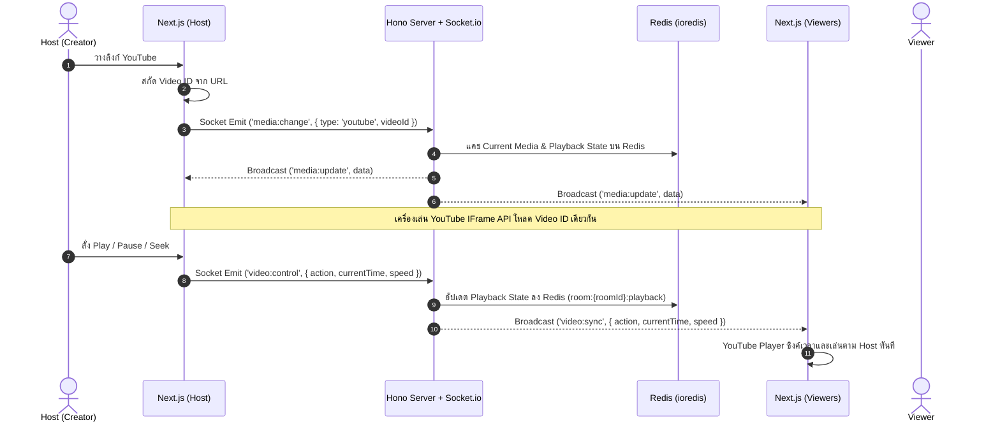
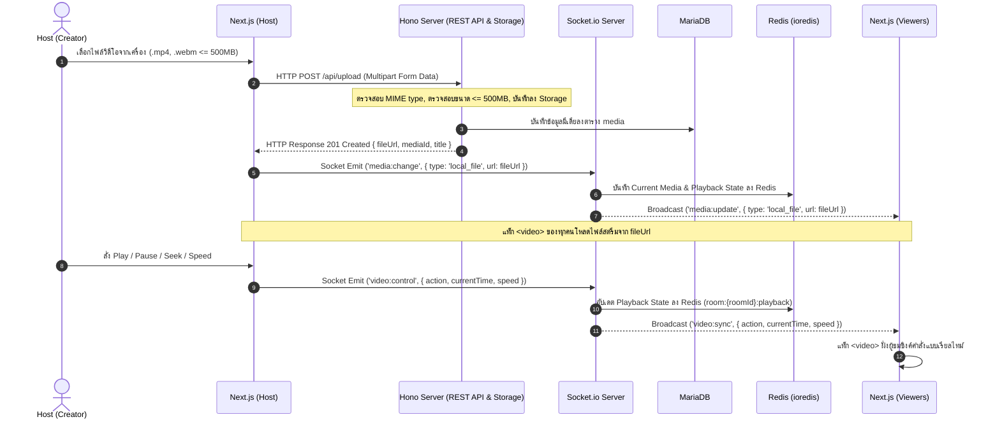
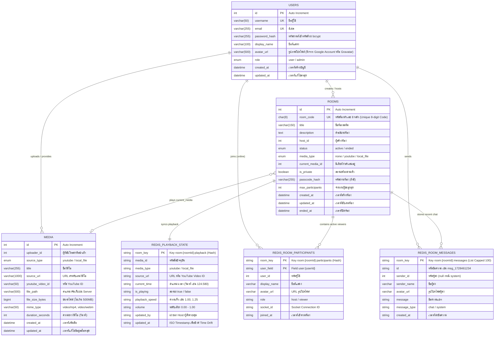

# 📄 Software Requirements Specification (SRS)

## 📌 ข้อมูลโครงงาน (Project Overview)
- **ชื่อโครงงาน (ภาษาไทย):** ยูสตรีม (ระบบรับชมวิดีโอร่วมกันแบบเรียลไทม์)
- **ชื่อโครงงาน (ภาษาอังกฤษ):** YouStream: Real-time Co-watching Platform
- **กลุ่มเป้าหมาย (Target Users):** 
  - กลุ่มเพื่อน ครอบครัว หรือกลุ่มผู้ใช้ทั่วไปที่ต้องการรับชมวิดีโอร่วมกันทางออนไลน์ในระยะไกล
  - ชุมชนออนไลน์ (Communities) หรือกลุ่มผู้ติดตามที่ต้องการจัดกิจกรรม Watch Party ร่วมกับผู้สร้างห้อง (Host)
  - ผู้ใช้งานที่ต้องการชมวิดีโอทั้งจาก YouTube หรือแชร์ไฟล์วิดีโอส่วนตัวร่วมกับผู้อื่นโดยไม่ต้องใช้ซอฟต์แวร์แชร์หน้าจอที่มีการกินแบนด์วิธสูง
- **ปัญหา / ที่มาของโครงงาน (Problem Statement & Pain Points):**
  - **ปัญหาความไม่ตรงกันของการเล่นวิดีโอ (Out-of-sync):** เมื่อผู้ใช้พยายามชมวิดีโอร่วมกันผ่านแอปพูดคุยทั่วไป มักต้องคอยนับถอยหลังกดเล่นพร้อมกัน ทำให้เกิดความคลาดเคลื่อนทางเวลา (Time Drift) และทำให้เสียอรรถรสในการรับชม
  - **การแชร์หน้าจอ (Screen Sharing) สิ้นเปลืองแบนด์วิธและคุณภาพต่ำ:** ซอฟต์แวร์แชร์หน้าจอทั่วไป (เช่น Discord, Zoom) ทำให้เครื่องของผู้แชร์ทำงานหนัก อาศัยอินเทอร์เน็ตความเร็วสูง และส่งผลให้คุณภาพของวิดีโอ (Bitrate/Framerate) ฝั่งผู้ชมลดลงอย่างมาก
  - **ข้อจำกัดของแพลตฟอร์ม Watch Party ทั่วไป:** แพลตฟอร์มส่วนใหญ่รองรับเฉพาะบริการสตรีมมิ่งภายนอกบางแห่ง ไม่รองรับการนำไฟล์วิดีโอส่วนตัว (Local Files เช่น .mp4, .webm) มาเปิดรับชมร่วมกันได้โดยตรง หรือมีข้อจำกัดเรื่องขนาดไฟล์และการควบคุมสิทธิ์
- **วัตถุประสงค์ (Objectives):**
  - เพื่อพัฒนาแพลตฟอร์มเว็บแอปพลิเคชันสำหรับการรับชมวิดีโอร่วมกันแบบเรียลไทม์ (Real-time Co-watching) ที่สามารถซิงโครไนซ์สถานะการเล่นระหว่างผู้สร้างห้อง (Host) และผู้ชม (Viewers) ได้อย่างแม่นยำ
  - เพื่อรองรับการเล่นสื่อจากหลากหลายแหล่ง (Multi-Source Media) ได้แก่ การเปิดวิดีโอจาก YouTube ผ่าน YouTube IFrame API และการอัปโหลดไฟล์วิดีโอจากเครื่องคอมพิวเตอร์ (Local Video Files ขนาดไม่เกิน 500MB) ไปยังระบบเพื่อสตรีมร่วมกัน
  - เพื่อพัฒนาระบบสิทธิ์การควบคุมโดย Host เพียงผู้เดียว (Host Control) ป้องกันความสับสนในการกดเล่น/หยุด/ข้ามเวลาจากผู้ใช้อื่น
  - เพื่อสร้างระบบหน้ารายการห้องรวม (Room Directory / Lobby) และห้องสนทนาเรียลไทม์ (Live Chat) ที่ช่วยเสริมสร้างปฏิสัมพันธ์ระหว่างผู้รับชม

---

## 👥 สมาชิกในกลุ่ม (Team Members)
| ลำดับ | รหัสนักศึกษา | ชื่อ - นามสกุล | บทบาทหน้าที่หลัก (Role) | GitHub Username |
| :---: | :---: | :--- | :--- | :--- |
| 1 | 6730300108 | นายชนกันต์ เขียวภักดี | Backend Developer / Database Designer | [@petegamez](https://github.com/petegamez) |
| 2 |  |  | Frontend Developer / UI Designer | [@Snowhazee](https://github.com/Snowhazee) |

---

## 🔗 ลิงก์ที่เกี่ยวข้อง (Important Deliverables Links)
- **Production URL (Deployed App):** [แนบลิงก์ที่ Deploy จริง เช่น Vercel / Railway]
- **GitHub Repository:** [https://github.com/PeterGamez/YouStream](https://github.com/PeterGamez/YouStream)
- **Figma Prototype:** [แนบลิงก์ Figma ที่แชร์สิทธิ์ Viewer]
- **Video Presentation & Demo:** [แนบลิงก์คลิป Unlisted เช่น YouTube / Google Drive]

### 🔑 บัญชีสำหรับทดสอบระบบ (Test Accounts)
| บทบาท (Role) | อีเมล / Username | รหัสผ่าน (Password) | สิทธิ์การเข้าถึง (Permissions) |
| :--- | :--- | :--- | :--- |
| Admin | `admin@youstream.app` | `Admin@1234` | จัดการผู้ใช้ทั้งหมด, ตรวจสอบและระงับห้องสตรีม, จัดการไฟล์วิดีโอบนระบบ |
| Host (User) | `host@youstream.app` | `Host@1234` | สร้างห้อง, สิทธิ์ควบคุมวิดีโอ (Host Control), อัปโหลดไฟล์วิดีโอ, จัดการห้อง |
| Viewer (User) | `viewer@youstream.app` | `Viewer@1234` | เข้าร่วมห้องสตรีม, ซิงค์การรับชม, ใช้งานแชทในห้อง, จัดการโปรไฟล์ |

---

## 🛠️ สถาปัตยกรรมและเทคโนโลยีที่ใช้ (Tech Stack)
- **Frontend:** 
  - Framework: [Next.js](https://nextjs.org/) (App Router, React 19)
  - Real-time Client: `socket.io-client`
  - Video Players: YouTube IFrame Player API (สำหรับ YouTube), HTML5 Video Element (สำหรับ Local File Streaming)
  - Styling: CSS Modules / Vanilla CSS (Modern Dark Theme UI)
- **Backend / API:** 
  - Server Framework: [Hono](https://hono.dev/) บน Node.js / Bun Runtime
  - Real-time Server: `socket.io` (จัดกลุ่มการกระจายข้อมูลผ่าน Socket Rooms)
  - In-Memory Cache & State Store: [Redis](https://redis.io/) ผ่านไดรเวอร์ `ioredis` (ใช้เฉพาะฝั่ง Backend สำหรับแคช Playback State แบบเรียลไทม์, แคชรายการ Active Rooms, และ Rate Limiting)
  - File Handling: Multi-part Form Data Parser (รองรับการอัปโหลดไฟล์วิดีโอขนาดไม่เกิน 500MB)
- **Database & Storage:** 
  - Relational Database Management System (RDBMS): [MariaDB](https://mariadb.org/) / MySQL (ไดรเวอร์ `mysql2` สำหรับจัดเก็บข้อมูลถาวร)
  - In-Memory Data Store (Backend Only): [Redis](https://redis.io/) (ไดรเวอร์ `ioredis` สำหรับ Fast In-Memory Cache)
- **Authentication & Security:** 
  - JSON Web Tokens (JWT) สำหรับการยืนยันตัวตนแบบ Stateless
  - Password Hashing: `bcrypt`
  - OAuth 2.0 (Google Login)
- **Hosting & Deployment:** 
  - Backend, Redis & Database: OVHcloud / Railway
  - Frontend: Vercel / Railway
- **CI/CD & Version Control:** 
  - Git, GitHub Actions

---

## 📋 ข้อกำหนดของระบบ (System Requirements)

### 1. Functional Requirements (FR)

| รหัส (ID) | โมดูล (Module) | รายละเอียดฟังก์ชันการทำงาน (Description) | ลำดับความสำคัญ |
| :---: | :--- | :--- | :---: |
| **FR-01** | Authentication | ผู้ใช้สามารถลงทะเบียน (Sign up) เข้าสู่ระบบ (Sign in) ด้วยอีเมลและรหัสผ่าน หรือผ่าน OAuth 2.0 (Google) โดยระบบจะกำหนด Avatar URL ให้อัตโนมัติจาก Google Account หรือดึงจาก [Gravatar](https://gravatar.com/) ผ่านแฮชของอีเมล | High |
| **FR-02** | Authentication | ระบบทำการเข้ารหัสรหัสผ่านด้วย `bcrypt` ก่อนจัดเก็บ และออก JSON Web Token (JWT) สำหรับยืนยันตัวตน | High |
| **FR-03** | User Profile | ผู้ใช้สามารถดูข้อมูลโปรไฟล์ (Display Name, Avatar URL) และเปลี่ยนรหัสผ่านได้ โดย Avatar URL จะดึงจาก Google Account หรือ Gravatar (https://gravatar.com/) | Medium |
| **FR-04** | Room Directory | หน้ารวมห้อง (Lobby) แสดงรายการห้องที่กำลังเปิดสตรีมอยู่ (Active Rooms) พร้อมชื่อห้อง, ชื่อ Host, ประเภทสื่อที่กำลังเล่น, และจำนวนผู้ชมปัจจุบัน | High |
| **FR-05** | Room Directory | ผู้ใช้สามารถค้นหาห้องตามชื่อห้อง หรือค้นหาด้วยรหัสห้องตัวเลข 8 หลัก (Room Code) หรือกรองตามสถานะ/ประเภทของสื่อได้ | Medium |
| **FR-06** | Room Management | สมาชิกสามารถสร้างห้องสตรีมมิ่งใหม่ได้ โดยกำหนดชื่อห้อง รายละเอียด และการตั้งค่าความเป็นส่วนตัว (Public / Passcode Protected) | High |
| **FR-07** | Room Management | ระบบสร้างรหัสห้องที่ไม่ซ้ำกันเป็นตัวเลข 8 หลัก (8-digit Unique Room Code เช่น `18492043`) เพื่อใช้ค้นหาห้อง หรือใช้เป็น URL ลิงก์สำหรับแชร์ให้ผู้ชมเข้าห้องได้ทันที | High |
| **FR-08** | Room Management | Host สามารถแก้ไขข้อมูลห้อง หรือสั่งปิดห้อง (End Room) ซึ่งจะนำผู้ใช้ออกจากห้องและเปลี่ยนสถานะเป็น Ended | High |
| **FR-09** | Host Control | ผู้สร้างห้อง (Host) เป็นผู้มีสิทธิ์ขาดเพียงคนเดียวในการควบคุมวิดีโอ (สั่ง Play, Pause, Seek/ข้ามเวลา, Volume, Playback Speed) | High |
| **FR-10** | Real-time Synchronization | เมื่อ Host ดำเนินการควบคุมวิดีโอ ระบบจะส่ง Event ผ่าน Socket.io ไปยัง Backend และทำการ Broadcast สถานะการเล่นไปยังผู้ชมทุกคนในห้องเดียวกันแบบเรียลไทม์ | High |
| **FR-11** | Late-Joiner Sync | เมื่อมีผู้ชมใหม่เข้าร่วมห้อง ระบบจะส่งสถานะปัจจุบันของวิดีโอ (Current Video, Time Offset, Playing State, Speed) ให้ผู้ใช้ใหม่ซิงค์ทันทีโดยไม่ต้องรอ Host สั่งการ | High |
| **FR-12** | YouTube Syncing | Host สามารถวางลิงก์ YouTube โดยระบบฝั่ง Frontend จะสกัดรหัส Video ID ออกมา แล้วส่งให้ Backend กระจายต่อไปยังผู้ชม | High |
| **FR-13** | YouTube Syncing | ฝั่งผู้ชมทำการแสดงผลวิดีโอผ่าน YouTube IFrame API และซิงค์สถานะตาม Host โดยไม่มีการดาวน์โหลดไฟล์วิดีโอมายังเซิร์ฟเวอร์ | High |
| **FR-14** | Local File Upload | Host สามารถเลือกไฟล์วิดีโอจากเครื่องคอมพิวเตอร์ (.mp4, .webm) ขนาดไม่เกิน 500MB และอัปโหลดไปยัง Backend ผ่าน Multipart API พร้อมแถบแสดงความคืบหน้า (Progress Bar) | High |
| **FR-15** | Local File Streaming | เซิร์ฟเวอร์ตรวจสอบความถูกต้องของไฟล์ บันทึกไฟล์ และส่งกลับเป็น Public URL สำหรับนำไปสตรีมผ่านแท็ก `<video>` ของเบราว์เซอร์ฝั่งผู้ชมทุกคน | High |
| **FR-16** | Media Switcher | Host สามารถสลับแหล่งวิดีโอระหว่าง YouTube และ Local Video File ได้ตลอดเวลาระหว่างเปิดห้องสตรีม | High |
| **FR-17** | In-Room Live Chat | ผู้ชมและ Host ในห้องสามารถส่งข้อความสนทนาแบบเรียลไทม์ผ่าน Socket.io ได้ | Medium |
| **FR-18** | Participant List | แสดงรายชื่อผู้เข้าร่วมห้องแบบเรียลไทม์ พร้อมสัญลักษณ์ระบุสถานะ Host | Medium |
| **FR-19** | Viewer Local Audio Control | ผู้ชมแต่ละคนสามารถปรับระดับเสียง (Local Volume) หรือปิดเสียง (Mute) บนเครื่องของตนเองได้ โดยไม่กระทบต่อผู้ใช้อื่นในห้อง | Medium |
| **FR-20** | Admin Dashboard | ผู้ดูแลระบบสามารถดูสถิติห้องที่กำลังเปิดใช้งาน, รายการผู้ใช้ทั้งหมด, และรายการไฟล์วิดีโอที่ถูกอัปโหลดในระบบ | Low |
| **FR-21** | Admin Management | ผู้ดูแลระบบสามารถสั่งปิดห้องที่ละเมิดข้อกำหนด และสั่งลบไฟล์วิดีโอขยะเพื่อคืนพื้นที่จัดเก็บ (Storage Cleanup) ได้ | Medium |

---

### 2. Non-Functional Requirements (NFR)

- **Performance & Latency:**
  - ค่าความหน่วงในการซิงค์สถานะวิดีโอ (Sync Latency) ผ่าน WebSocket/Socket.io ต้องน้อยกว่า 200 มิลลิวินาที ภายใต้สภาวะเครือข่ายอินเทอร์เน็ตปกติ
  - RESTful API ทั่วไปของ Hono ต้องมี Response Time เฉลี่ยไม่เกิน 300 มิลลิวินาที
  - ใช้ **Redis** ในฝั่ง Backend เพื่อแคชสถานะการเล่นวิดีโอล่าสุด (`Playback State`) และข้อมูลห้องออนไลน์แบบ In-Memory ช่วยให้ Late-joiner ซิงค์ได้รวดเร็วระดับมิลลิวินาที และลดภาระ I/O การอ่าน/เขียนซ้ำ ๆ บน MariaDB
  - ระบบรองรับการอัปโหลดไฟล์วิดีโอขนาดใหญ่ (สูงสุด 500MB) ได้อย่างราบรื่นโดยไม่บล็อก Event Loop ของเซิร์ฟเวอร์
- **Security & Authorization:**
  - รหัสผ่านของผู้ใช้ต้องถูกเข้ารหัสด้วย `bcrypt` (Salt Rounds >= 10)
  - มีการตรวจสอบสิทธิ์ (Authorization Middleware) เพื่อให้มั่นใจว่าคำสั่งควบคุมวิดีโอ (Play, Pause, Seek, Change Source) ส่งมาจาก Host ของห้องนั้นจริง
  - มีการตรวจสอบไฟล์อัปโหลดอย่างเคร่งครัด: ตรวจสอบ MIME Type (รองรับเฉพาะ `video/mp4`, `video/webm`), ขนาดไฟล์ไม่เกิน 500MB และป้องกันช่องโหว่ Path Traversal ในการจัดเก็บไฟล์
  - การเรียกใช้งาน API มีการป้องกัน SQL Injection ผ่าน Prepared Statements ของ `mysql2` และป้องกัน XSS บนระบบแชท
- **Usability & Responsiveness:**
  - รองรับการแสดงผลแบบ Responsive Design อย่างสมบูรณ์ทั้งบน Desktop (หน้าจอหลักสำหรับ Watch Party), Tablet และ Mobile
  - ใช้ชุดสีสไตล์ Dark Theme ที่ถนอมสายตาสำหรับการรับชมสื่อบันเทิงในที่มืด
- **Reliability & Scalability:**
  - ระบบมีกลไก Auto-Reconnection ของ Socket.io เพื่อเชื่อมต่อใหม่และดึงสถานะล่าสุดกลับมาเมื่ออินเทอร์เน็ตขัดข้องชั่วคราว
  - ระบบห้องแบ่งการสื่อสารด้วย Socket Room Channels เพื่อจำกัดปริมาณข้อมูลการ Broadcast ให้เฉพาะผู้ใช้ในห้องนั้นๆ
  - Backend รองรับการเชื่อมต่อกับ Redis เพื่อใช้เป็น Caching Layer และพร้อมต่อยอดเป็น Socket.io Redis Adapter สำหรับรองรับการขยายตัวในอนาคต

---

## 🎭 Use Cases & User Flow

### 1. Actors ในระบบ
1. **User / Member (ผู้ใช้งานระบบ):** ผู้ใช้ที่ลงทะเบียนและเข้าสู่ระบบแล้ว สามารถค้นหาห้องสตรีมมิ่ง สร้างห้อง หรือเข้าร่วมห้องของผู้อื่นได้
2. **Host (ผู้สร้างห้อง):** ผู้ใช้ที่เป็นเจ้าของห้อง มีสิทธิ์เต็มในการควบคุมการเล่นวิดีโอ (Host Control) เปลี่ยนแหล่งวิดีโอ อัปโหลดไฟล์ และปิดห้อง
3. **Viewer (ผู้ชม):** ผู้ใช้ที่เข้าร่วมห้องสตรีมของผู้อื่น วิดีโอจะซิงค์ตาม Host และสามารถแชทพูดคุยกับผู้ใช้อื่นในห้องได้
4. **Admin (ผู้ดูแลระบบ):** ผู้ดูแลภาพรวมของระบบ จัดการห้อง ผู้ใช้ และพื้นที่จัดเก็บไฟล์

---

### 2. ตารางสรุป Use Case สำคัญ
| Use Case ID | Actor | ชื่อ Use Case | คำอธิบายสั้นๆ (Description) |
| :---: | :--- | :--- | :--- |
| **UC-01** | User | Register & Login | สมัครสมาชิกและเข้าสู่ระบบด้วย Email/Password หรือ Google OAuth เพื่อรับ JWT Token |
| **UC-02** | User | Browse Room Directory | ดูรายการห้องสตรีมทั้งหมดที่เปิดอยู่ ค้นหาห้อง และคลิกเพื่อเข้าร่วมห้อง |
| **UC-03** | User | Create Stream Room | สร้างห้องสตรีมมิ่งใหม่ กำหนดชื่อ รายละเอียด และรหัสผ่านเข้าห้อง (ถ้ามี) |
| **UC-04** | Host | Stream YouTube Video | นำลิงก์ YouTube มาใส่ ระบบสกัด Video ID และกระจายให้ผู้ชมทุกคนในห้องเล่นพร้อมกัน |
| **UC-05** | Host | Upload & Stream Local File | อัปโหลดไฟล์วิดีโอขนาดไม่เกิน 500MB รับ Public URL และบรอดแคสต์ให้ผู้ชมสตรีมผ่าน HTML5 Video |
| **UC-06** | Host | Control Video Playback | สั่ง Play, Pause, Seek, ปรับ Speed หรือระดับเสียง โดยระบบจะซิงค์ไปยังผู้ชมทุกคนแบบเรียลไทม์ |
| **UC-07** | Viewer | Watch & Auto-Sync Video | เข้ารับชมวิดีโอในห้อง โดยระบบจะซิงค์สถานะการเล่นให้ตรงกับ Host โดยอัตโนมัติตลอดเวลา |
| **UC-08** | Host / Viewer | In-Room Live Chat | ส่งข้อความสนทนาและแสดงความเห็นกับคนอื่นๆ ภายในห้องสตรีมมิ่ง |
| **UC-09** | Host | Close / End Room | สั่งสิ้นสุดการสตรีม ปิดห้อง และเตือนให้ผู้ชมทุกคนออกจากห้อง |
| **UC-10** | Admin | Manage System & Storage | ตรวจสอบห้องสตรีมมิ่ง ระงับห้องที่ไม่เหมาะสม และลบไฟล์วิดีโอที่หมดอายุออกจากเซิร์ฟเวอร์ |

---

### 3. แผนภาพลำดับการทำงาน (Workflows & How it Works)

#### 🎬 กลไกที่ 1: การเปิดวิดีโอจาก YouTube (YouTube Syncing)


---

#### 📁 กลไกที่ 2: การนำไฟล์วิดีโอมาเอง (Local File via Server Upload <= 500MB)


---

## 🗄️ โครงสร้างฐานข้อมูลและการจัดการสถานะ (Database & In-Memory State Schema)

ระบบแบ่งการจัดการข้อมูลในฝั่ง Backend ออกเป็น 2 ส่วนตามสถาปัตยกรรม High-Performance Real-Time:
1. **MariaDB / MySQL (Persistent Database):** สำหรับจัดเก็บข้อมูลเชิงสัมพันธ์หลักของระบบอย่างถาวร (Users, Rooms, Media) ตาม ER Diagram และ Data Dictionary ในหัวข้อที่ 1 และ 2
2. **Redis (In-Memory Data Store & Cache - ใช้เฉพาะฝั่ง Backend ผ่าน `ioredis`):** สำหรับจัดเก็บและจัดการข้อมูลสถานะแบบเรียลไทม์ทั้งหมด (Real-time Video Playback State, Active Participants Presence, Ephemeral Room Messages, Active Rooms List, และ Chat Rate Limiting) ตามรายละเอียดในหัวข้อที่ 3 เพื่อลดภาระ Disk I/O บน MariaDB ให้เหลือเฉพาะข้อมูลถาวร และทำให้ระบบตอบสนองได้เร็วระดับ Sub-millisecond

### 1. Entity Relationship Diagram (ER Diagram)

ไดอะแกรมแสดงแบบจำลองข้อมูลภาพรวมของระบบ (Overall Conceptual Data Model) ซึ่งผสานการทำงานระหว่าง **MariaDB (Persistent Relational Database)** สำหรับจัดเก็บข้อมูลถาวร และ **Redis (In-Memory State Store)** สำหรับจัดเก็บสถานะแบบเรียลไทม์:



---

### 2. พจนานุกรมข้อมูล (Data Dictionary & Table Specifications)

#### 2.1 ตาราง `users` (ตารางข้อมูลผู้ใช้งาน)
| ชื่อฟิลด์ (Field) | ชนิดข้อมูล (Data Type) | Nullable | Constraints / Default | คำอธิบาย (Description) |
| :--- | :--- | :---: | :--- | :--- |
| `id` | `INT` | NO | PRIMARY KEY, AUTO_INCREMENT | รหัสประจำตัวผู้ใช้ (Auto Increment) |
| `username` | `VARCHAR(50)` | NO | UNIQUE | ชื่อบัญชีผู้ใช้สำหรับล็อกอินและอ้างอิง |
| `email` | `VARCHAR(255)` | NO | UNIQUE | อีเมลสำหรับล็อกอินและการติดต่อ |
| `password_hash` | `VARCHAR(255)` | YES | NULL (อนุญาต NULL สำหรับ Google OAuth) | รหัสผ่านที่ผ่านการเข้ารหัสด้วย bcrypt |
| `display_name` | `VARCHAR(100)` | NO | - | ชื่อที่ต้องการให้แสดงในห้องและแชท |
| `avatar_url` | `VARCHAR(500)` | YES | NULL | URL รูปภาพโปรไฟล์ ดึงจาก Google Account (กรณี Google OAuth) หรือดึงจาก [Gravatar](https://gravatar.com/) ผ่าน Email Hash |
| `role` | `ENUM('user', 'admin')` | NO | DEFAULT `'user'` | สิทธิ์ระดับผู้ใช้งานในระบบ |
| `created_at` | `DATETIME` | NO | DEFAULT `CURRENT_TIMESTAMP` | วันและเวลาที่สมัครสมาชิก |
| `updated_at` | `DATETIME` | NO | DEFAULT `CURRENT_TIMESTAMP ON UPDATE CURRENT_TIMESTAMP` | วันและเวลาที่อัปเดตข้อมูลล่าสุด |

---

#### 2.2 ตาราง `rooms` (ตารางข้อมูลห้องสตรีมมิ่ง)
| ชื่อฟิลด์ (Field) | ชนิดข้อมูล (Data Type) | Nullable | Constraints / Default | คำอธิบาย (Description) |
| :--- | :--- | :---: | :--- | :--- |
| `id` | `INT` | NO | PRIMARY KEY, AUTO_INCREMENT | รหัสประจำตัวห้อง (Auto Increment) |
| `room_code` | `CHAR(8)` | NO | UNIQUE | รหัสประจำห้องเป็นตัวเลข 8 หลักไม่ซ้ำกัน (Unique 8-digit Code เช่น `12345678`) สำหรับค้นหาและแชร์ URL |
| `title` | `VARCHAR(150)` | NO | - | ชื่อห้องสตรีมมิ่งที่แสดงใน Room Directory |
| `description` | `TEXT` | YES | NULL | คำอธิบายรายละเอียดเกี่ยวกับห้องหรือวิดีโอ |
| `host_id` | `INT` | NO | - | ผู้สร้างห้องที่มีสิทธิ์ Host Control |
| `status` | `ENUM('active', 'ended')` | NO | DEFAULT `'active'` | สถานะของห้อง (กำลังเปิดอยู่ หรือ ปิดแล้ว) |
| `media_type` | `ENUM('none', 'youtube', 'local_file')` | NO | DEFAULT `'none'` | ชนิดของสื่อที่กำลังสตรีมอยู่ขณะนี้ |
| `current_media_id` | `INT` | YES | NULL | อ้างอิงวิดีโอปัจจุบันที่กำลังเล่น |
| `is_private` | `BOOLEAN` | NO | DEFAULT `FALSE` | ห้องส่วนตัว (ต้องใส่รหัสผ่านก่อนเข้า) |
| `passcode_hash` | `VARCHAR(255)` | YES | NULL | รหัสผ่านเข้าห้องที่ผ่านการ Hash (ถ้ามี) |
| `max_participants` | `INT` | NO | DEFAULT `50` | จำนวนผู้ชมสูงสุดที่อนุญาตในห้อง |
| `created_at` | `DATETIME` | NO | DEFAULT `CURRENT_TIMESTAMP` | วันเวลาที่สร้างห้อง |
| `updated_at` | `DATETIME` | NO | DEFAULT `CURRENT_TIMESTAMP ON UPDATE CURRENT_TIMESTAMP` | วันเวลาที่มีการแก้ไขข้อมูลห้อง |
| `ended_at` | `DATETIME` | YES | NULL | วันเวลาที่ Host สั่งปิดห้อง |

---

#### 2.3 ตาราง `media` (ตารางสื่อวิดีโอ ทั้ง YouTube และ Local File)
| ชื่อฟิลด์ (Field) | ชนิดข้อมูล (Data Type) | Nullable | Constraints / Default | คำอธิบาย (Description) |
| :--- | :--- | :---: | :--- | :--- |
| `id` | `INT` | NO | PRIMARY KEY, AUTO_INCREMENT | รหัสประจำตัวสื่อ (Auto Increment) |
| `uploader_id` | `INT` | NO | - | ผู้ใช้ที่นำเข้าหรืออัปโหลดวิดีโอนี้ |
| `source_type` | `ENUM('youtube', 'local_file')` | NO | - | แหล่งที่มาของวิดีโอ (YouTube หรือไฟล์เซิร์ฟเวอร์) |
| `title` | `VARCHAR(255)` | NO | - | ชื่อของคลิปวิดีโอหรือชื่อไฟล์เดิม |
| `source_url` | `VARCHAR(1000)` | NO | - | URL ของวิดีโอสำหรับสตรีม หรือ YouTube URL |
| `youtube_video_id` | `VARCHAR(50)` | YES | NULL | รหัส Video ID ของ YouTube (เช่น `dQw4w9WgXcQ`) |
| `file_path` | `VARCHAR(500)` | YES | NULL | Path ตำแหน่งไฟล์จริงบนเซิร์ฟเวอร์ (กรณี local file) |
| `file_size_bytes` | `BIGINT` | YES | NULL | ขนาดไฟล์หน่วยไบต์ (ตรวจสอบไม่เกิน 500MB = 524,288,000 bytes) |
| `mime_type` | `VARCHAR(50)` | YES | NULL | ประเภทไฟล์ เช่น `video/mp4`, `video/webm` |
| `duration_seconds` | `INT` | YES | NULL | ความยาวของวิดีโอในหน่วยวินาที |
| `created_at` | `DATETIME` | NO | DEFAULT `CURRENT_TIMESTAMP` | วันเวลาที่เพิ่มข้อมูลสื่อ |
| `updated_at` | `DATETIME` | NO | DEFAULT `CURRENT_TIMESTAMP ON UPDATE CURRENT_TIMESTAMP` | วันเวลาที่มีการแก้ไขข้อมูลสื่อล่าสุด |

---

### 3. โครงสร้างข้อมูล In-Memory บน Redis (Redis Data Structures Schema)

> **ข้อกำหนดสถาปัตยกรรม:** 
> - เชื่อมต่อและประมวลผล Redis ด้วยไลบรารี `ioredis` **เฉพาะฝั่ง Backend (Hono / Node.js Runtime)** เท่านั้น เพื่อความปลอดภัยของข้อมูล
> - ออกแบบให้จัดเก็บข้อมูลสถานะเรียลไทม์และข้อมูลชั่วคราว (Transient State) ทั้งหมดบน RAM ของ Redis เพื่อลดภาระ Disk I/O บน MariaDB และให้ความเร็วในการตอบสนองระดับ Sub-millisecond

#### 3.1 สรุปรูปแบบ Key และชนิดข้อมูลบน Redis (Redis Key Summary)
| รูปแบบ Key (Key Pattern) | ชนิดข้อมูล (Data Type) | คำสั่งหลัก (Commands) | วัตถุประสงค์และการทำงาน | นโยบายการหมดอายุ (TTL / Expiration) |
| :--- | :--- | :--- | :--- | :--- |
| `room:{roomId}:playback` | **Hash** | `HSET`, `HGETALL`, `HMSET`, `EXPIRE` | ซิงค์สถานะการเล่นวิดีโอปัจจุบัน (เวลา, เล่น/หยุด, ความเร็ว, เสียง) ส่งให้ผู้ชมทุกคนและ Late-joiner | ลบเมื่อปิดห้อง (`status = 'ended'`) หรือตั้ง TTL 24 ชม. |
| `room:{roomId}:participants` | **Hash** | `HSET`, `HDEL`, `HGETALL`, `HVALS`, `HLEN` | บันทึกรายชื่อและสถานะของผู้ใช้ที่กำลังออนไลน์ในห้องแบบเรียลไทม์ (Field: `user:{userId}`) | ลบ Field เมื่อผู้ใช้ออกจากห้อง (`HDEL`) หรือลบ Key เมื่อปิดห้อง |
| `room:{roomId}:messages` | **List** | `RPUSH`, `LTRIM`, `LRANGE` | จัดเก็บประวัติข้อความแชทล่าสุดในห้องแบบ Capped List (จำกัด 100 ข้อความล่าสุด) | ลบเมื่อปิดห้อง หรือตั้ง TTL 24 ชม. |
| `socket:{socketId}:session` | **Hash** | `HSET`, `HGETALL`, `DEL` | แมป Socket ID กลับไปยัง `userId` และ `roomId` สำหรับจัดการ Disconnect แบบ $O(1)$ | ลบทันทีเมื่อ Socket Disconnect |
| `active_rooms` | **Set** | `SADD`, `SREM`, `SMEMBERS`, `SCARD` | เก็บรายชื่อ `roomId` ที่กำลังเปิดอยู่ สำหรับแสดงใน Room Lobby ได้รวดเร็ว | เพิ่มเมื่อเปิดห้อง (`SADD`) และลบเมื่อปิดห้อง (`SREM`) |
| `ratelimit:chat:{userId}` | **String** | `SET ... EX 1 NX` | จำกัดความถี่การส่งแชทป้องกันสแปม (Rate Limit 1 ข้อความ / 1 วินาที) | TTL 1 วินาที (หมดอายุอัตโนมัติ) |

#### 3.2 รายละเอียดและโครงสร้างข้อมูลเชิงลึก (In-Depth Schema Specifications)

##### 3.2.1 สถานะการเล่นวิดีโอแบบเรียลไทม์ (`room:{roomId}:playback` - Hash)
- **Key ตัวอย่าง:** `room:101:playback`
- **Fields & Values:**
  | Field | ชนิดข้อมูล | ตัวอย่างค่า | คำอธิบาย |
  | :--- | :--- | :--- | :--- |
  | `mediaId` | `string` (Integer) | `"1"` | รหัสสื่อวิดีโอปัจจุบันที่กำลังเล่น (หรือ `""` หากยังไม่เปิดสื่อ) |
  | `mediaType` | `string` | `"youtube"` | ประเภทของสื่อ (`"youtube"`, `"local_file"` หรือ `"none"`) |
  | `sourceUrl` | `string` | `"dQw4w9WgXcQ"` | URL ของไฟล์วิดีโอ หรือ YouTube Video ID สำหรับสตรีม |
  | `currentTime` | `string` (Float) | `"124.580"` | ตำแหน่งเวลาของวิดีโอปัจจุบัน (วินาที ละเอียดถึงทศนิยม 3 ตำแหน่ง) |
  | `isPlaying` | `string` (Boolean) | `"true"` | สถานะกำลังเล่น (`true`) หรือหยุดชั่วคราว (`false`) |
  | `playbackSpeed` | `string` (Float) | `"1.25"` | ความเร็วในการเล่นวิดีโอที่ Host กำหนด |
  | `volume` | `string` (Float) | `"1.00"` | ระดับเสียงหลักของ Host (0.00 - 1.00) |
  | `updatedBy` | `string` (Integer) | `"5"` | `id` ของ Host ผู้สั่งควบคุมล่าสุด |
  | `updatedAt` | `string` (ISO 8601) | `"2026-10-09T15:20:00.123Z"` | เวลาที่ส่งคำสั่ง เพื่อนำไปคำนวณ Time Drift ชดเชยความหน่วงฝั่งผู้ชม |
- **คำสั่งและกลไกการทำงาน:** บันทึกสถานะด้วยคำสั่ง `HSET` หรือ `HMSET room:{roomId}:playback` และดึงข้อมูลสถานะล่าสุดส่งให้ Late-joiner ด้วยคำสั่ง `HGETALL room:{roomId}:playback`

##### 3.2.2 รายชื่อผู้เข้าร่วมและสถานะออนไลน์ (`room:{roomId}:participants` - Hash)
- **Key ตัวอย่าง:** `room:101:participants`
- **Field:** `user:{userId}` (เช่น `user:5`, `user:12`)
- **Value (JSON Schema):**
  ```json
  {
    "userId": 5,
    "displayName": "SomsakDev",
    "avatarUrl": "https://lh3.googleusercontent.com/a/...",
    "role": "host",
    "socketId": "sock_xY99aK10",
    "joinedAt": "2026-10-09T15:10:00.000Z"
  }
  ```
- **กลไกการทำงาน (Operations):**
  - **บันทึกผู้ใช้เข้าห้อง:** บันทึกข้อมูลด้วยคำสั่ง `HSET room:{roomId}:participants user:{userId} <JSON>`
  - **ลบผู้ใช้ออกจากห้อง:** ลบข้อมูลด้วยคำสั่ง `HDEL room:{roomId}:participants user:{userId}`
  - **นับจำนวนผู้ชมในห้อง:** ตรวจสอบได้ทันทีด้วยคำสั่ง `HLEN room:{roomId}:participants` (ความเร็ว $O(1)$)
  - **ดึงรายชื่อผู้ชมทั้งหมด:** ดึงรายการทั้งหมดด้วยคำสั่ง `HVALS room:{roomId}:participants`

##### 3.2.3 ประวัติข้อความแชทในห้อง (`room:{roomId}:messages` - Capped List)
- **Key ตัวอย่าง:** `room:101:messages`
- **Value (JSON Schema ใน List):**
  ```json
  {
    "id": "msg_1728461234567",
    "senderId": 5,
    "senderName": "SomsakDev",
    "avatarUrl": "https://lh3.googleusercontent.com/a/...",
    "message": "คลิปนี้สนุกมากเลยครับ!",
    "messageType": "chat",
    "createdAt": "2026-10-09T15:12:45.000Z"
  }
  ```
- **กลไกการทำงาน (Operations):**
  - **ส่งข้อความใหม่และจำกัด 100 ข้อความ:** บันทึกข้อความด้วยคำสั่ง `RPUSH room:{roomId}:messages <JSON>` และตัดประวัติไม่ให้เกิน 100 ข้อความด้วยคำสั่ง `LTRIM room:{roomId}:messages -100 -1`
  - **ดึงประวัติแชทให้ Late-joiner:** ดึงข้อความทั้งหมดด้วยคำสั่ง `LRANGE room:{roomId}:messages 0 -1`

##### 3.2.4 ตรวจสอบ Session เมื่อ Socket หลุดการเชื่อมต่อ (`socket:{socketId}:session` - Hash)
- **Key ตัวอย่าง:** `socket:sock_xY99aK10:session`
- **Fields:**
  - `userId`: `"5"`
  - `roomId`: `"101"`
- **กลไกการทำงาน (Operations):** เมื่อ Socket หลุดการเชื่อมต่อ (Disconnect) ดึงข้อมูลด้วยคำสั่ง `HGETALL socket:{socketId}:session` เพื่อทราบ `roomId` และ `userId` จากนั้นลบผู้ใช้ออกจากห้องด้วยคำสั่ง `HDEL` และลบคีย์ด้วยคำสั่ง `DEL` แบบ $O(1)$ โดยไม่ต้องวนลูปค้นหา

##### 3.2.5 รายการห้องที่เปิดใช้งาน (`active_rooms` - Set)
- **Key:** `active_rooms`
- **Members:** `roomId` (เช่น `"101"`, `"102"`, `"205"`)
- **กลไกการทำงาน (Operations):**
  - **เปิดห้อง:** บันทึกรหัสห้องเข้าเซตด้วยคำสั่ง `SADD active_rooms {roomId}`
  - **ปิดห้อง:** ลบรหัสห้องออกจากเซตด้วยคำสั่ง `SREM active_rooms {roomId}`
  - **ดึงรายการห้องออนไลน์ทั้งหมด:** ดึงรายการทั้งหมดด้วยคำสั่ง `SMEMBERS active_rooms`

##### 3.2.6 ป้องกันการส่งแชทรัว / สแปม (`ratelimit:chat:{userId}` - String with TTL)
- **Key ตัวอย่าง:** `ratelimit:chat:5`
- **กลไกการทำงาน (Operations):** ตรวจสอบและล็อกการส่งข้อความด้วยคำสั่ง `SET ratelimit:chat:{userId} "1" EX 1 NX` หากคืนค่า `null` แสดงว่ายังไม่พ้นช่วงจำกัดเวลา (1 วินาที) ให้ปฏิเสธข้อความและแจ้งเตือนผู้ใช้ทันที

---

## ⚡ สเปกการสื่อสารแบบเรียลไทม์ (Socket.io Event Specifications)

เพื่อให้การทำงานระหว่าง Frontend Next.js และ Backend Hono ระบบกำหนด Event หลักดังนี้:

| หมวดหมู่ (Category) | ชื่อ Event (Event Name) | ทิศทาง (Direction) | ข้อมูลที่ส่ง (Payload) | คำอธิบาย (Description) |
| :--- | :--- | :--- | :--- | :--- |
| **Room Connection** | `room:join` | Client -> Server | `{ roomId, passcode? }` | ผู้ใช้ขอเข้าร่วมห้องสตรีม |
| | `room:joined` | Server -> Client | `{ roomInfo, playbackState, participants, recentMessages }` | ส่งข้อมูลห้อง, สถานะวิดีโอจาก Redis, รายชื่อผู้ใช้ และประวัติแชทล่าสุดให้ Late-joiner |
| | `room:leave` | Client -> Server | `{ roomId }` | ผู้ใช้ออกจากห้อง |
| | `room:user-joined` | Server -> Room | `{ userId, displayName, role }` | แจ้งเตือนทุกคนในห้องเมื่อมีคนเข้ามาใหม่ |
| | `room:user-left` | Server -> Room | `{ userId, displayName }` | แจ้งเตือนทุกคนในห้องเมื่อมีคนออกไป |
| **Media Selection** | `media:change` | Host -> Server | `{ roomId, sourceType, youtubeId?, fileUrl?, title }` | Host สั่งเปลี่ยนวิดีโอ (YouTube หรือ Local file) |
| | `media:update` | Server -> Room | `{ mediaId, sourceType, youtubeId?, fileUrl?, title }` | กระจายวิดีโอใหม่ให้ทุกคนในห้องสลับเครื่องเล่นพร้อมกัน |
| **Playback Sync** | `video:control` | Host -> Server | `{ roomId, action, currentTime, speed?, volume? }` | Host สั่งควบคุม (action: `play`, `pause`, `seek`, `ratechange`) |
| | `video:sync` | Server -> Viewers | `{ action, currentTime, speed, timestamp }` | Broadcast คำสั่งให้เฉพาะฝั่ง Viewers ซิงค์เวลาตามทันที |
| **Live Chat** | `chat:send` | Client -> Server | `{ roomId, message }` | ผู้ใช้ส่งข้อความแชทในห้อง |
| | `chat:new-message` | Server -> Room | `{ id, senderName, message, createdAt }` | กระจายข้อความใหม่ให้ทุกคนในห้องเห็นทันที |
| **System & Error** | `error` | Server -> Client | `{ message }` | ส่งข้อความแจ้งเตือนเมื่อเกิดข้อผิดพลาด (เช่น รหัสผ่านผิด, ติด Rate Limit แชท) |